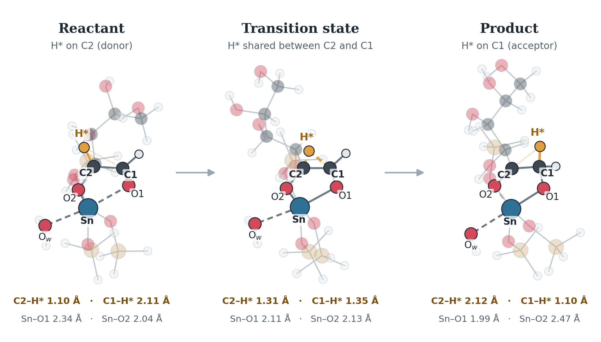

::: {.hero-status .stacked}
<span>[Reconstructed model]{.tag .wip} not literature coordinates; charge 0 / singlet inferred</span>
<span>[Certified]{.tag .cert} MACE-OMOL-1024 saddle</span>
<span>[Certified · reproduced]{.tag .cert} MACE-POLAR saddle; Tian's values reproduced</span>
<span>[Structurally invalid]{.tag .bad} GFN2-xTB, for barrier comparison</span>
<span>[Pending]{.tag .open} accuracy against DFT: Gaussian data not yet received</span>
:::

::: {.scope}
[What "certified" means here]{.lbl}
A **verified first-order saddle** on that model's own potential-energy surface, for this
reconstructed cluster with an inferred charge and spin, whose ±imaginary-mode relaxations
reach valid reactant-like and product-like minima. It says **nothing about accuracy against
DFT**, and the ±mode check is **not an IRC**.
:::

```{=html}
<figure class="hero-figure">
  <picture>
    <source media="(max-width: 640px)" srcset="assets/sn_beta_reaction_stacked.png">
    
  </picture>
  <figcaption>
    The C2→C1 hydride transfer on the reconstructed 42-atom vacuum cluster, open-chain
    glucose bound to a SiH₃-capped Sn site, in one Sn-centred orientation (product and
    reactant aligned to the TS on Sn/O1/O2/C1/C2). The transferring hydride H* (amber)
    moves from C2 to C1, and the O1/O2 roles at Sn swap. Geometries: Tian's
    MACE-POLAR-1-S-relaxed endpoints and his saved Sella saddle (tt-test, commit b97ef46);
    they are hand-built structures, not the paper's coordinates. Spectator atoms are faded.
    Generated by <code>site/build_sn_beta_figures.py</code>.
  </figcaption>
</figure>
```

## Where things stand: OMOL against POLAR {#sec-numbers}

Both models were run on the same 42-atom cluster, vacuum electronic energies, with the same
protocol where it was run. Every barrier below names its reference state, and the two
conventions are always shown together.

::: {.numgrid}
::: {.numcard .ref-ep}
[−40.6 [kJ/mol]{.small}]{.v}
[OMOL − POLAR · `relaxed_endpoint`]{.est}
[forward barrier 72.33 against 112.97]{.ref}
:::

::: {.numcard .ref-cs}
[−35.6 [kJ/mol]{.small}]{.v}
[OMOL − POLAR · `connected_side_minimum`]{.est}
[forward barrier 90.77 against 126.41]{.ref}
:::

::: {.numcard .saved}
[? [vs DFT]{.small}]{.v}
[which model is closer: not yet known]{.est}
[needs Tian's Gaussian reference calculations, which have not arrived]{.ref}
:::
:::

```{=html}
<div class="cmp-wrap reveal">
<table class="cmp" data-quarto-disable-processing="true">
  <caption>
    Same reconstructed cluster, vacuum electronic energies (no ZPE or thermal terms; not free
    energies), kJ/mol. Bars share one scale (0–140 kJ/mol); hatched bars are negative values.
    <code>relaxed_endpoint</code> measures from the relaxed input reactant;
    <code>connected_side_minimum</code> measures from the reactant-side minimum reached by
    relaxing away from the saddle. POLAR values are Tian's, reproduced by our pipeline.
    Source: <code>sweep/sn_beta_hydride/audit/omol_benchmark/</code>.
  </caption>
  <thead>
    <tr>
      <th scope="col">Quantity</th>
      <th scope="col" class="m-omol">MACE-OMOL-1024</th>
      <th scope="col" class="m-polar">MACE-POLAR</th>
      <th scope="col">OMOL − POLAR</th>
    </tr>
  </thead>
  <tbody>
    <tr class="grp"><th colspan="4">Forward barrier = E(TS) − E(reference reactant)</th></tr>
    <tr>
      <th scope="row"><code>relaxed_endpoint</code><small>reference: relaxed input reactant</small></th>
      <td data-label="MACE-OMOL-1024"><span class="val">72.33</span><span class="bar omol" style="--w:51.7%"><i></i></span></td>
      <td data-label="MACE-POLAR"><span class="val">112.97</span><span class="bar polar" style="--w:80.7%" ><i></i></span></td>
      <td class="d" data-label="OMOL − POLAR"><span class="val">−40.6</span><small class="u">kJ/mol</small></td>
    </tr>
    <tr>
      <th scope="row"><code>connected_side_minimum</code><small>reference: reactant-side minimum reached from the saddle</small></th>
      <td data-label="MACE-OMOL-1024"><span class="val">90.77</span><span class="bar omol" style="--w:64.8%"><i></i></span></td>
      <td data-label="MACE-POLAR"><span class="val">126.41</span><span class="bar polar" style="--w:90.3%"><i></i></span></td>
      <td class="d" data-label="OMOL − POLAR"><span class="val">−35.6</span><small class="u">kJ/mol</small></td>
    </tr>
    <tr class="grp"><th colspan="4">Reaction energy ΔE = E(P) − E(R), same two references</th></tr>
    <tr>
      <th scope="row"><code>relaxed_endpoint</code></th>
      <td data-label="MACE-OMOL-1024"><span class="val">−27.22</span><span class="bar omol neg" style="--w:19.4%"><i></i></span></td>
      <td data-label="MACE-POLAR"><span class="val">−30.02</span><span class="bar polar neg" style="--w:21.4%"><i></i></span></td>
      <td class="d na" data-label="OMOL − POLAR"><span class="dash">—</span></td>
    </tr>
    <tr>
      <th scope="row"><code>connected_side_minimum</code></th>
      <td data-label="MACE-OMOL-1024"><span class="val">−4.62</span><span class="bar omol neg" style="--w:3.3%"><i></i></span></td>
      <td data-label="MACE-POLAR"><span class="val">−19.17</span><span class="bar polar neg" style="--w:13.7%"><i></i></span></td>
      <td class="d na" data-label="OMOL − POLAR"><span class="dash">—</span></td>
    </tr>
    <tr class="grp"><th colspan="4">The saddle itself, and the reactant conformer</th></tr>
    <tr>
      <th scope="row">Imaginary mode<small>exactly one, below −50 cm⁻¹</small></th>
      <td data-label="MACE-OMOL-1024"><span class="val">−1299<small>cm⁻¹</small></span></td>
      <td data-label="MACE-POLAR"><span class="val">−923<small>cm⁻¹</small></span></td>
      <td class="d na" data-label="OMOL − POLAR"><span class="dash">—</span></td>
    </tr>
    <tr>
      <th scope="row">Hydride-mode overlap<small>with the C2–H*–C1 transfer coordinate</small></th>
      <td data-label="MACE-OMOL-1024"><span class="val">0.72</span></td>
      <td data-label="MACE-POLAR"><span class="val">0.75</span></td>
      <td class="d na" data-label="OMOL − POLAR"><span class="dash">—</span></td>
    </tr>
    <tr>
      <th scope="row">R-side conformer offset<small>E(relaxed R) − E(R′), see below</small></th>
      <td data-label="MACE-OMOL-1024"><span class="val">18.4<small>kJ/mol</small></span><span class="bar omol" style="--w:13.2%"><i></i></span></td>
      <td data-label="MACE-POLAR"><span class="val">13.4<small>kJ/mol</small></span><span class="bar polar" style="--w:9.6%"><i></i></span></td>
      <td class="d na" data-label="OMOL − POLAR"><span class="dash">—</span></td>
    </tr>
  </tbody>
</table>
</div>
```

What the comparison shows, and what it does not:

- **Both models describe the same hydride-transfer saddle.** Each has exactly one imaginary
  mode dominated by the transferring H, the same Sn–O set at the saddle, and the two saddle
  geometries differ by 0.40 Å over the whole cluster (0.095 Å for the reactive core). Starting
  the OMOL saddle search from Tian's POLAR saddle gives the identical OMOL saddle.
- **OMOL puts the barrier 40.6 / 35.6 kJ/mol lower** than POLAR, depending on which reference
  state is used, and it differs most from POLAR in the connected-side reaction energy
  (−4.62 against −19.17 kJ/mol).
- **That does not make OMOL more accurate.** A lower barrier is not a better barrier. These are
  two models on one reconstructed cluster with no reference calculation; **DFT is required to
  decide which model is closer to the target surface.**

## Is the gap just geometry or path noise? {#sec-geometry}

A fair worry: OMOL and POLAR relax to slightly different structures, so the gap could reflect
which geometries were used. The check is to evaluate **both** models on **both** sets of saved
structures, with single-point energies and no relaxation.

```{=html}
<div class="cmp-wrap reveal">
<table class="cmp geo" data-quarto-disable-processing="true">
  <caption>
    Single-point energy differences at fixed, saved geometries, in kJ/mol. These are
    <strong>not</strong> relaxed barriers. R and R′ are each method's own relaxed reactant and
    TS-connected reactant-side minimum. Bars share one scale (0–140 kJ/mol). Source:
    <code>audit/omol_benchmark/cross_evaluation.json</code>, reproduced by <code>cross_evaluate.py</code>.
  </caption>
  <thead>
    <tr>
      <th scope="col">Energy difference</th>
      <th scope="col">On POLAR's saved structures</th>
      <th scope="col">On OMOL's saved structures</th>
    </tr>
  </thead>
  <tbody>
    <tr>
      <th scope="row">E(TS) − E(R)</th>
      <td data-label="On POLAR's structures">
        <div class="pair"><b>POLAR</b><div><span class="v">113.0</span><span class="bar polar" style="--w:80.7%"><i></i></span></div></div>
        <div class="pair"><b>OMOL</b><div><span class="v">74.7</span><span class="bar omol" style="--w:53.4%"><i></i></span></div></div>
        <span class="gap">OMOL lower by <strong>38</strong> kJ/mol</span>
      </td>
      <td data-label="On OMOL's structures">
        <div class="pair"><b>POLAR</b><div><span class="v">123.5</span><span class="bar polar" style="--w:88.2%"><i></i></span></div></div>
        <div class="pair"><b>OMOL</b><div><span class="v">72.3</span><span class="bar omol" style="--w:51.6%"><i></i></span></div></div>
        <span class="gap">OMOL lower by <strong>51</strong> kJ/mol</span>
      </td>
    </tr>
    <tr>
      <th scope="row">E(TS) − E(R′)</th>
      <td data-label="On POLAR's structures">
        <div class="pair"><b>POLAR</b><div><span class="v">126.4</span><span class="bar polar" style="--w:90.3%"><i></i></span></div></div>
        <div class="pair"><b>OMOL</b><div><span class="v">93.7</span><span class="bar omol" style="--w:66.9%"><i></i></span></div></div>
        <span class="gap">OMOL lower by <strong>33</strong> kJ/mol</span>
      </td>
      <td data-label="On OMOL's structures">
        <div class="pair"><b>POLAR</b><div><span class="v">132.5</span><span class="bar polar" style="--w:94.6%"><i></i></span></div></div>
        <div class="pair"><b>OMOL</b><div><span class="v">90.8</span><span class="bar omol" style="--w:64.9%"><i></i></span></div></div>
        <span class="gap">OMOL lower by <strong>42</strong> kJ/mol</span>
      </td>
    </tr>
  </tbody>
</table>
</div>
```

OMOL stays **33 to 51 kJ/mol** below POLAR on every structure set tested, so the disagreement
is a **difference between the two potential-energy surfaces**, not just relaxation or path noise.
This shows the gap is not a geometry artefact. It does not explain why the models differ, and it
does not say which one is right.

## Saddle certification is not path convergence {#sec-neb}

For MACE-OMOL these are two separate facts, and only one of them is good news.

```{=html}
<div class="lanes reveal">
  <div class="lane diag">
    <span class="tag wip state">Unconverged · diagnostic only</span>
    <h4>13-image climbing-image NEB</h4>
    <div class="gauge" role="img" aria-label="NEB force 0.594 electron-volts per angstrom, about twelve times above the 0.05 target, on a logarithmic axis">
      <div class="track"><div class="fill" style="--w:88.7%"></div>
        <span class="tick" style="--x:34.9%" data-l="target 0.05"></span></div>
      <div class="legend"><span>0.01</span><span>fmax 0.594 eV/Å after 1500 steps</span><span>1</span></div>
    </div>
    <ul>
      <li>Did <strong>not</strong> converge: fmax 0.594 eV/Å against a target of 0.05.</li>
      <li>No converged reaction path or minimum-energy path is claimed.</li>
      <li>Its highest image is only a starting guess: <strong>not</strong> the transition state and <strong>not</strong> a barrier.</li>
    </ul>
  </div>
  <div class="lane">
    <span class="tag cert state">Converged · certified</span>
    <h4>Sella saddle search from that guess</h4>
    <div class="gauge" role="img" aria-label="Sella force 7.1 times ten to the minus four electron-volts per angstrom, below the 1 times ten to the minus three target, on a logarithmic axis">
      <div class="track"><div class="fill" style="--w:21.3%"></div>
        <span class="tick" style="--x:25.0%" data-l="target 1×10⁻³"></span></div>
      <div class="legend"><span>10⁻⁴</span><span>fmax 7.1×10⁻⁴ eV/Å in 26 steps</span><span>1</span></div>
    </div>
    <ul>
      <li>Own Hessian: exactly one imaginary mode, −1299 cm⁻¹, overlap 0.72 with the hydride transfer.</li>
      <li>±mode relaxations reach a reactant-like and a product-like minimum; Sn shell, bound water and hydride state intact on both.</li>
      <li>A different seed, Tian's POLAR saddle, converges to the <strong>same</strong> OMOL saddle (same energy, RMSD 0.001 Å).</li>
    </ul>
  </div>
</div>
```

The certification rule is about the **saddle only**. It requires a converged Sella search, one
imaginary mode, a hydride-transfer mode, and valid ± minima; it does not depend on how the
starting guess was found. The NEB status is reported next to it and never merged into it.

## POLAR: independently re-run through our pipeline {#sec-polar}

Tian's MACE-POLAR numbers were first recomputed from his saved raw energies. Our pipeline then
re-ran the cheap validation ladder on them:

::: {.checklist .done}
- The endpoint inputs were already POLAR-relaxed (our relaxation took 0 steps).
- Tian's saddle was already stationary (fmax 6.9×10⁻⁴ eV/Å; our Sella record is 0 steps).
- **Hessian recomputed:** one imaginary mode, −923.08 cm⁻¹, overlap 0.75 with the hydride transfer.
- **±mode connectivity recomputed:** reactant-like and product-like side minima.
- **Barriers reproduced exactly:** 112.97 (`relaxed_endpoint`) and 126.41 (`connected_side_minimum`) kJ/mol.
- **Reaction energies reproduced:** −30.02 and −19.17 kJ/mol.
- The POLAR saddle is **certified** under the same rules as OMOL's.
:::

One limit on that evidence: because the saddle was already stationary, the Sella record is
trivial, so the independent evidence is our Hessian and the ±mode connectivity. The path
behind Tian's saddle was a relaxed scan, not an NEB, and was not re-run.

## The reference you measure from matters {#sec-energy}

::: {.wide-figure}
![The POLAR reference-state example: one saddle measured from two reactant references. Solid:
the relaxed input endpoints (barrier 112.97, ΔE −30.02 kJ/mol). Dashed: the minima reached by
relaxing away from the saddle along its imaginary mode (barrier 126.41, ΔE −19.17 kJ/mol).
The reactant-side minimum R′ lies 13.44 kJ/mol below the relaxed input reactant R while its
reactive core is essentially unchanged (RMSD 0.08 Å). Energies are relative to R, in vacuum,
not free energies. Source:
`audit/tian_tt_test/tian_polar_summary.json`, recomputed from Tian's
saved total energies and reproduced by our re-run.](assets/sn_beta_energy_profile.png){width="100%" fig-alt="Energy-level diagram of the MACE-POLAR example: relaxed input reactant R at 0, reactant-side connected minimum R′ at −13.44, transition state at +112.97, product-side connected minimum P′ at −32.60 and relaxed input product P at −30.02 kJ/mol, with barrier arrows of 112.97 (from R) and 126.41 (from R′)."}
:::

This is a **scientific result**, not a loose end. Moving from the relaxed input reactant R to the
TS-connected nearby conformer R′ shifts the reported barrier by:

- **13.4 kJ/mol for POLAR** (112.97 → 126.41), and
- **18.4 kJ/mol for OMOL** (72.33 → 90.77).

```{=html}
<div class="dumb reveal" role="img" aria-label="Forward barrier measured from two reactant references. MACE-POLAR: 112.97 from the relaxed input reactant and 126.41 from the connected reactant-side minimum, a shift of 13.4 kilojoules per mole. MACE-OMOL: 72.33 and 90.77, a shift of 18.4 kilojoules per mole.">
  <div class="drow">
    <b>MACE-POLAR</b>
    <div class="dtrack"><span class="dseg" style="--a:80.7%;--b:90.3%"></span><span class="dot ep" style="--x:80.7%" data-v="112.97"></span><span class="dot cs" style="--x:90.3%" data-v="126.41"></span></div>
    <span class="dlab">+13.4<small>kJ/mol</small></span>
  </div>
  <div class="drow">
    <b>MACE-OMOL</b>
    <div class="dtrack"><span class="dseg" style="--a:51.7%;--b:64.8%"></span><span class="dot ep" style="--x:51.7%" data-v="72.33"></span><span class="dot cs" style="--x:64.8%" data-v="90.77"></span></div>
    <span class="dlab">+18.4<small>kJ/mol</small></span>
  </div>
  <div class="dscale"><span></span><span class="s"><span>0</span><span>70</span><span>140 kJ/mol</span></span><span></span></div>
  <div class="dleg"><i class="ep"></i>from <code>relaxed_endpoint</code> R <i class="cs"></i>from <code>connected_side_minimum</code> R′</div>
</div>
```

In both models the reactive core barely changes (reactive-core RMSD 0.083 Å for POLAR, 0.019 Å
for OMOL), while one backbone torsion, C1–C2–C4–O5, turns by about −70° (POLAR) or −87° (OMOL).
Both shifts are above the roughly 10 kJ/mol level we use to call a change material (an analysis
threshold, not a universal one). **Which nearby reactant structure defines the reference changes
the barrier materially**, so any comparison must say which one it uses.

R′ is a lower **local** minimum, reached by relaxing away from the saddle. It is not shown to be
the global minimum, and no conformer search has been done. No sampled structure should be read
as the global minimum.

## GFN2-xTB: a structural negative result {#sec-xtb}

GFN2-xTB **cannot be used as a reference** for this cluster in vacuum. When the reconstructed
reactant is relaxed, the Sn-bound water leaves the metal centre.

```{=html}
<figure class="track-fig reveal">
<svg viewBox="0 0 640 196" role="img" aria-label="Sn to water-oxygen distance before and after GFN2-xTB relaxation. In the reactant it grows from 2.31 to 3.12 angstrom, beyond the 2.80 angstrom shell cutoff, so the water has left. In the product it stays inside the shell, 2.38 to 2.64 angstrom.">
  <rect x="70" y="30" width="308.6" height="142" fill="#eef6f0"/>
  <rect x="378.6" y="30" width="231.4" height="142" fill="#fdf0ef"/>
  <line x1="378.6" y1="26" x2="378.6" y2="172" stroke="#1f2933" stroke-width="1.2" stroke-dasharray="4 3"/>
  <text x="372" y="22" text-anchor="end">inside the Sn shell</text>
  <text x="386" y="22">outside · water has left</text>

  <text x="76" y="52" class="lab">Reactant · Sn–O(water)</text>
  <line x1="70" y1="70" x2="610" y2="70" stroke="#c9d0d6" stroke-width="1.2"/>
  <line x1="189.6" y1="70" x2="502" y2="70" stroke="#c1121f" stroke-width="1.6" stroke-dasharray="3 3"/>
  <circle cx="189.6" cy="70" r="7" fill="#fff" stroke="#1f2933" stroke-width="2"/>
  <g transform="translate(189.6,70)"><g class="mv" style="transform:translateX(312.4px)"><circle r="7.5" fill="#c1121f"/></g></g>
  <text x="189.6" y="94" text-anchor="middle">input 2.31 Å</text>
  <text x="502" y="94" text-anchor="middle" class="lab" style="fill:#c1121f">xTB-relaxed 3.12 Å</text>

  <text x="76" y="117" class="lab">Product · Sn–O(water)</text>
  <line x1="70" y1="135" x2="610" y2="135" stroke="#c9d0d6" stroke-width="1.2"/>
  <line x1="216.6" y1="135" x2="316.9" y2="135" stroke="#3f7d4e" stroke-width="1.6" stroke-dasharray="3 3"/>
  <circle cx="216.6" cy="135" r="7" fill="#fff" stroke="#1f2933" stroke-width="2"/>
  <g transform="translate(216.6,135)"><g class="mv" style="transform:translateX(100.3px)"><circle r="7.5" fill="#3f7d4e"/></g></g>
  <text x="224" y="159" text-anchor="end">input 2.38 Å</text>
  <text x="372" y="159" text-anchor="end" class="lab" style="fill:#3f7d4e">xTB-relaxed 2.64 Å</text>

  <g>
    <line x1="70" y1="172" x2="610" y2="172" stroke="#1f2933" stroke-width="1"/>
    <text x="70" y="188" text-anchor="middle">2.0</text><text x="224.3" y="188" text-anchor="middle">2.4</text>
    <text x="378.6" y="188" text-anchor="middle">2.8 Å cutoff</text><text x="532.9" y="188" text-anchor="middle">3.2</text>
  </g>
</svg>
<figcaption>
  Sn to water-oxygen distance, in Å, before (open circle) and after (filled) GFN2-xTB relaxation,
  judged against the input structure of the same role with the same rule used for every method
  (a heavy atom leaving a 2.80 Å Sn shell; the cutoff is an analysis threshold). In the reactant
  O1 also weakens, 2.34 → 2.71 Å. Source: <code>audit/omol_benchmark/xtb_sanity__xtb_sanity.json</code>.
</figcaption>
</figure>
```

**Status: structurally invalid for barrier comparison.** The reactant loses the water
(2.31 → 3.12 Å), so the xTB system is no longer the same chemistry as the MACE ones. The
product stays intact, but a barrier needs both ends. We therefore show **no xTB barrier**, did
not run a path search with it, and do not treat xTB as a reference. The failure is loss of Sn
coordination, not simply a "bad barrier".

## Which OMOL checkpoint? {#sec-checkpoint}

::: {.methodnote}
[A training-subset comparison, not model-size scaling]{.lbl}
The MACE-OMOL release provides no smaller model: both checkpoints are the same extra-large
architecture. The only second checkpoint, trained on a 4M subset of the data, was run through a
cheap ladder (relaxation, Sella seeded from the 1024 saddle, Hessian, ±mode connectivity). Barriers
move by **+0.86** (`relaxed_endpoint`) and **−0.61** kJ/mol (`connected_side_minimum`); the
relaxed-endpoint ΔE shifts by about **6.0** kJ/mol (−27.22 → −21.20) for a reason we have not
isolated. This is a small check, not a scaling law, and its saddle was seeded from the 1024
saddle, so it is not an independent path search. Do not over-interpret it.
:::

## What is and is not established {#sec-reconstructed}

[Directly demonstrated]{.tag .demo} — from the benchmark run and its saved outputs:

- **Two certified saddles.** MACE-OMOL-1024 and MACE-POLAR each give a verified first-order
  saddle, with valid reactant-like and product-like ± minima, on this reconstructed cluster.
- **Tian's POLAR numbers are reproduced** by our Hessian and connectivity re-run.
- **The two models disagree on energetics:** forward barriers differ by 40.6 / 35.6 kJ/mol
  (depending on reference state), and the gap persists at identical saved geometries.
- **The reported barrier depends on the reference conformer:** by 13.4 kJ/mol (POLAR) and
  18.4 kJ/mol (OMOL).
- **GFN2-xTB loses the Sn-bound water** in the reactant relaxation.
- **OMOL's 13-image CI-NEB did not converge** (fmax 0.594 against a target of 0.05 eV/Å).

[Supported interpretation]{.tag .interp} The two models describe the same chemical event (one
hydride-transfer saddle with a hydride-dominated imaginary mode) but through different surfaces.
The 1024 and 4M OMOL checkpoints agree to within about 1 kJ/mol on the barrier.

[Not demonstrated]{.tag .open} These are not established:

- **accuracy against DFT**, or which model is closer to it: no reference calculation exists yet
- a **converged reaction path** for OMOL
- that R′, or any sampled conformer, is the **lowest** conformer
- that the reconstructed cluster is the **original literature geometry**, or that the charge and
  spin (0 / singlet) are the right ones
- any solvent effect, or any free-energy or experimental comparison.

## Does the reconstructed chemistry look right? {#sec-structure}

::: {.wide-figure}
{width="100%" fig-alt="Three-by-three grid of orthogonal projections of reactant, transition state and product, with the Sn centre and the transferring hydride H* highlighted."}
:::

::: {.observations}
- Hydride on **C2** in the reactant (C2–H\* 1.10 Å, C1–H\* 2.11 Å)
- **Shared** between C2 and C1 at the transition state (1.31 / 1.35 Å)
- Hydride on **C1** in the product (2.12 / 1.10 Å)
- At Sn, O1 and O2 swap roles as intended: Sn–O1 2.34 → 1.99 Å, Sn–O2 2.04 → 2.47 Å
- Six O lie within 2.8 Å of Sn in both endpoints. In the product Sn–O2 (2.47 Å) is just beyond a
  2.46 Å bond criterion, so five O are within it: a coordination change, not a neutral swap
- Reconstructed structures: hand-built and relaxed with MACE-POLAR-1-S, **not** original
  CPMD coordinates
:::

## Pipeline status {#sec-status}

```{=html}
<div class="cmp-wrap reveal">
<table class="stages" data-quarto-disable-processing="true">
  <colgroup><col style="width:21%"><col style="width:27%"><col style="width:26%"><col style="width:26%"></colgroup>
  <caption>
    Status by stage on the reconstructed cluster. Each stage is run by our pipeline unless stated.
    "Saddle status" is the certification rule above and concerns the saddle only.
  </caption>
  <thead>
    <tr><th scope="col">Stage</th><th scope="col">MACE-OMOL-1024</th><th scope="col">MACE-POLAR</th><th scope="col">GFN2-xTB</th></tr>
  </thead>
  <tbody>
    <tr><th scope="row">Reconstructed R / P</th><td class="span" colspan="3"><span class="st2 done">done</span> Tian's POLAR-relaxed endpoints, provenance-labelled</td></tr>
    <tr><th scope="row">Structure validation</th><td class="span" colspan="3"><span class="st2 done">done</span> composition, atom map, caps, hydride state, Sn shell; 0 errors</td></tr>
    <tr><th scope="row">Endpoint relaxation</th>
      <td data-label="OMOL"><span class="st2 done">done</span></td>
      <td data-label="POLAR"><span class="st2 done">done</span><small>0 steps: already relaxed</small></td>
      <td data-label="xTB"><span class="st2 fail">failed structurally</span><small>reactant loses Sn-bound water</small></td></tr>
    <tr><th scope="row">CI-NEB (13 images)</th>
      <td data-label="OMOL"><span class="st2 diag">attempted · unconverged, diagnostic</span></td>
      <td data-label="POLAR"><span class="st2 na">not run</span><small>Tian used a relaxed scan</small></td>
      <td data-label="xTB"><span class="st2 na">not run</span></td></tr>
    <tr><th scope="row">Sella saddle search</th>
      <td data-label="OMOL"><span class="st2 done">done · converged</span><small>26 steps</small></td>
      <td data-label="POLAR"><span class="st2 done">done · converged</span><small>0 steps: seeded at his saddle</small></td>
      <td data-label="xTB"><span class="st2 na">not run</span></td></tr>
    <tr><th scope="row">Hessian</th>
      <td data-label="OMOL"><span class="st2 done">done</span><small>one imaginary mode</small></td>
      <td data-label="POLAR"><span class="st2 done">done</span><small>recomputed</small></td>
      <td data-label="xTB"><span class="st2 na">not run</span></td></tr>
    <tr><th scope="row">±mode connectivity</th>
      <td data-label="OMOL"><span class="st2 done">done</span><small>not an IRC</small></td>
      <td data-label="POLAR"><span class="st2 done">done</span><small>recomputed; not an IRC</small></td>
      <td data-label="xTB"><span class="st2 na">not run</span></td></tr>
    <tr><th scope="row">Saddle status</th>
      <td data-label="OMOL"><span class="st2 cert">certified</span></td>
      <td data-label="POLAR"><span class="st2 cert">certified</span> <span class="st2 done">reproduced</span></td>
      <td data-label="xTB"><span class="st2 fail">structurally invalid</span></td></tr>
    <tr><th scope="row">Gaussian DFT reference</th><td class="span" colspan="3"><span class="st2 pend">pending</span> data not yet received; nothing is shown or estimated</td></tr>
  </tbody>
</table>
</div>
```

## Next question {#sec-next}

::: {.nextq}
[The research question]{.pillar-section-label}
[Which foundation model is closer to DFT, and how many DFT calculations are actually needed
to recover a trustworthy barrier?]{.q}
:::

**Tian's Gaussian reference calculations have not arrived, and no DFT result appears anywhere on
this page.** The sequence below is blocked on them:

```{=html}
<ol class="timeline reveal">
  <li class="now">Receive Tian's Gaussian reference calculations along R → TS → P<span class="st2 diag">waiting</span><small>the parser and analysis code exist but have only been tested on synthetic fixtures, never on real Gaussian output</small></li>
  <li>Compare OMOL and POLAR energy errors against DFT along R → TS → P<span class="st2 pend">after 1</span></li>
  <li>Compare force RMSE, force magnitudes and cosine similarity<span class="st2 pend">after 1</span></li>
  <li>Identify where the model error concentrates (reactive core, Sn site, spectators)<span class="st2 pend">after 1</span></li>
  <li>Test uniform against TS-enriched sparse DFT labelling; TS-enriched is a hypothesis, not an assumption<span class="st2 pend">after 1</span></li>
  <li>Measure barrier error against the number and location of DFT calculations<span class="st2 pend">after 1</span></li>
  <li>Only later, launch blind MACE metadynamics<span class="st2 pend">later</span><small>readiness checklist only; no MACE metadynamics has been launched</small></li>
</ol>
```

---

## Background and provenance {#sec-question}

**Reference.** S. H. Mushrif, J. J. Varghese, C. B. Krishnamurthy, *Solvation dynamics
and energetics of intramolecular hydride transfer reactions in biomass conversion*,
Phys. Chem. Chem. Phys. **17**, 4961–4969 (2015),
DOI [10.1039/C4CP05063K](https://doi.org/10.1039/C4CP05063K).

The immediate experiment is narrower than the original study: whether these models give
a physically meaningful transition pathway between known initial and final states,
initially *without* reproducing the full explicit-solvent metadynamics.

**The reconstructed model.** Tian built a 42-atom vacuum model by hand: open-chain
glucose bound to a SiH₃-capped Sn site, C₆H₂₂O₁₀Si₃Sn, interpreting the literature
drawing. He relaxed it with MACE-POLAR-1-S and ran a relaxed scan, a Sella saddle
search and a Hessian. These are **not** the paper's coordinates. The neutral singlet
charge state is an **inferred** model choice, not literature-confirmed.

Sources:
[`audit/omol_benchmark/`](https://github.com/tiangroup-uofa/ml-accelerated-metadynamics/tree/main/sweep/sn_beta_hydride/audit/omol_benchmark)
(curated benchmark results),
[`OMOL_BENCHMARK_REPORT.md`](https://github.com/tiangroup-uofa/ml-accelerated-metadynamics/blob/main/sweep/sn_beta_hydride/OMOL_BENCHMARK_REPORT.md),
[`audit/tian_tt_test/`](https://github.com/tiangroup-uofa/ml-accelerated-metadynamics/tree/main/sweep/sn_beta_hydride/audit/tian_tt_test)
(`tian_polar_summary.json`, `input_validation.json`, `structure_views.png`) and
[`input/tian_tt_test/provenance.json`](https://github.com/tiangroup-uofa/ml-accelerated-metadynamics/tree/main/sweep/sn_beta_hydride/input/tian_tt_test).

### Why new foundation models {#sec-why}

MACE-OFF23, used for the Diels–Alder benchmark, was trained on organic chemistry and
has no tin. MACE-OMOL-0 and MACE-POLAR-1 cover elements up to Z = 83, Sn included, and
both take the system's total charge and spin multiplicity as inputs. MACE-POLAR adds
long-range electrostatics. This is the first test of the project's pipeline on a
catalytic, metal-containing system.

### Pipeline and checks {#sec-infrastructure}

[Exercised on the real cluster]{.tag .demo} by this benchmark:

::: {.checklist .done}
- Strict structure validation that refuses to start a calculation on invalid input
- Endpoint relaxation, CI-NEB, Sella saddle refinement, mass-weighted Hessian
  ([standard](methods.qmd#sec-ts)) and ±imaginary-mode connectivity
- Barriers and reaction energies always reported against a named reference state — the
  relaxed input endpoints, or the minima connected to the saddle
- Total charge and multiplicity always set explicitly; the models otherwise default silently
  to a neutral singlet
- GFN2-xTB as a third method under the same protocol (used here as a structural check)
:::

Added with the benchmark, after review:

::: {.checklist .done}
- A saddle is certified only with a **converged Sella search** on record, one imaginary mode,
  a hydride-transfer mode, and valid ± minima
- Each ± side minimum must keep its Sn shell, bound water, heavy-atom bonds and hydride state
  relative to the input structure; an invalid side gives no reference energy
- NEB status is reported separately from the saddle label, so an unconverged NEB can never be
  mistaken for a converged path
:::

[Built, tested on synthetic fixtures only]{.tag .wip} Gaussian-log ingestion, DFT-against-MACE
energy and force metrics, and a sparse-DFT-label experiment framework. They have never been run on
real Gaussian output. A metadynamics readiness checklist exists; **no MACE metadynamics has been
launched**.

### Blocked on authoritative information {#sec-blockers}

[Work in progress]{.tag .wip} The production configuration for **authoritative**
structures still stops before loading a model, by design, until these are supplied:

::: {.checklist .blocked}
- Authoritative reactant coordinates
- Authoritative product coordinates
- Total charge
- Spin multiplicity
- Atom mapping (which atoms are C1, C2, the transferring hydride, Sn, and the
  coordinating oxygens)
- The original CPMD collective-variable parameters d₀, p, q
- Fixed / capped-atom policy for the cluster model
- The intended solvent / cluster representation for this experiment
:::

### What the literature does and does not establish {#sec-literature}

The paper itself is closed access and has not been read in full; the points below come
from its abstract and from a thesis that reproduces its Fig. 1 (M. A. Y. Ali, MSc thesis,
University of Alberta, 2025). Nothing here has been checked against the paper's full
text.

- [Literature]{.tag .lit} **Protocols.** The paper uses CPMD-metadynamics with explicit water
  or methanol, a CPMD-metadynamics run without solvent, and implicit-solvent DFT
  (abstract). The thesis's own dataset is a 20,000-timestep **gas-phase** run; whether it
  is the paper's solvent-free run is not established.
- [Literature, as drawn]{.tag .lit} **Model.** The thesis figure adapted from the paper draws the
  site as a SiH₃-capped Sn cluster, Sn(–O–SiH₃)₃, with open-chain glucose bound through
  its C1 and C2 oxygens and the water formed at the site remaining on Sn.
- [Literature, secondary]{.tag .lit} **Collective variables.** CV1 is the coordination
  number of C1 with the two hydrogens H1 and H2; CV2 is the coordination number of C2
  with the same two hydrogens, using CPMD's rational coordination function.
- [Unknown]{.tag .open} **CV parameters d₀, p, q.** The project's code computes these CVs
  with **placeholder** parameters that are explicitly flagged as unconfirmed, and refuses
  to compare against the reference basin values until the originals are supplied.
- [Unknown]{.tag .open} **Charge and multiplicity** — not stated in either source.

::: {.methodnote}
[Not a reference value]{.lbl}
The "≈82 kJ/mol barrier" sometimes quoted for this reaction comes from data tips on the
thesis's **gas-phase metadynamics free-energy plot**, not from a verified published value.
It is a free-energy difference from a biased-sampling run; an endpoint-to-endpoint NEB or
Sella calculation gives a potential-energy barrier, and the two are not directly
comparable. It is not used here as ground truth.
:::

The code and its tests are in
[`sweep/sn_beta_hydride/`](https://github.com/tiangroup-uofa/ml-accelerated-metadynamics/tree/main/sweep/sn_beta_hydride),
with the full literature audit in its README.
