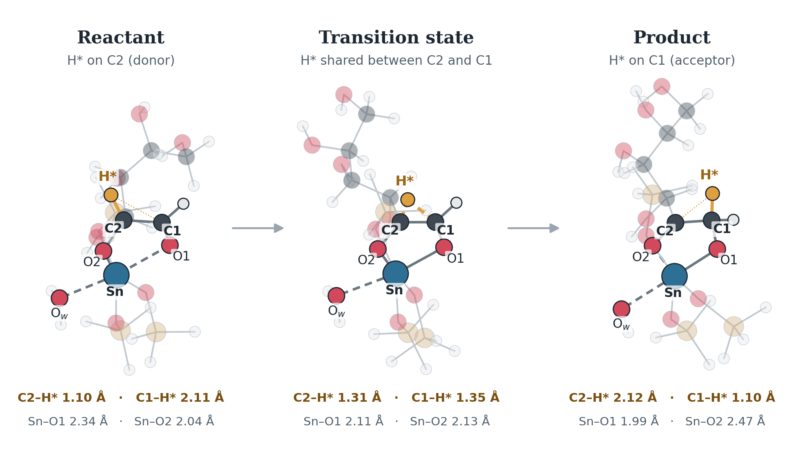

::: {.hero-status}
<span>[Work in progress]{.tag .wip} reconstructed model, not literature coordinates</span>
<span>[Reproduced]{.tag .demo} MACE-POLAR energies from saved raw data</span>
<span>[Not re-certified]{.tag .open} saddle point</span>
<span>[Not yet run]{.tag .open} standardized OMOL / POLAR / xTB comparison</span>
:::

```{=html}
<figure class="hero-figure">
  <picture>
    <source media="(max-width: 640px)" srcset="assets/sn_beta_reaction_stacked.png">
    
  </picture>
  <figcaption>
    The C2→C1 hydride transfer on the reconstructed 42-atom vacuum cluster, open-chain
    glucose bound to a SiH₃-capped Sn site, in one Sn-centred orientation (product and
    reactant aligned to the TS on Sn/O1/O2/C1/C2). The transferring hydride H* (amber)
    moves from C2 to C1, and the O1/O2 roles at Sn swap. Geometries: Tian's
    MACE-POLAR-1-S-relaxed endpoints and his saved Sella saddle (tt-test, commit b97ef46).
    The saddle has not been independently re-certified, and these are hand-built
    structures, not the paper's coordinates. Spectator atoms are faded.
    Generated by <code>site/build_sn_beta_figures.py</code>.
  </figcaption>
</figure>
```

## Where things stand {#sec-numbers}

MACE-POLAR-1-S electronic energies in vacuum, recomputed from Tian's saved raw energies:

::: {.numgrid}
::: {.numcard .ref-ep}
[112.97 [kJ/mol]{.small}]{.v}
[barrier · `relaxed_endpoint`]{.est}
[E(TS) − E(relaxed input reactant)]{.ref}
[ΔE(P−R) **−30.02** kJ/mol]{.alt}
:::

::: {.numcard .ref-cs}
[126.41 [kJ/mol]{.small}]{.v}
[barrier · `connected_side_minimum`]{.est}
[E(TS) − E(reactant-side minimum reached by relaxing away from the saddle)]{.ref}
[ΔE(P−R) **−19.17** kJ/mol]{.alt}
:::

::: {.numcard .saved}
[−923 [cm⁻¹]{.small}]{.v}
[one imaginary mode · saved record]{.est}
[Tian's saved Hessian, dominated by H*; not recomputed by our pipeline]{.ref}
:::
:::

::: {.wip-banner}
[Not a benchmark result]{.lbl}
These numbers come from a hand-built model with an inferred neutral-singlet charge state,
and the saddle is not independently certified. Both barrier values describe the **same
saddle**: they differ only in which reactant structure is the reference.
:::

## Why there are two barrier values {#sec-energy}

::: {.wide-figure}
![The same saddle measured from two reactant references. Solid: the relaxed input
endpoints (barrier 112.97, ΔE −30.02 kJ/mol). Dashed: the minima reached by relaxing away
from the saddle along its imaginary mode (barrier 126.41, ΔE −19.17 kJ/mol). The
reactant-side minimum R′ lies 13.44 kJ/mol below the relaxed input reactant R while its
reactive core is essentially unchanged (RMSD 0.08 Å), so the gap is conformational.
Neither reactant structure is shown to be the global minimum. Energies are relative to R.
Source: `sweep/sn_beta_hydride/audit/tian_tt_test/tian_polar_summary.json`, recomputed from
Tian's saved total energies.](assets/sn_beta_energy_profile.png){width="100%" fig-alt="Energy-level diagram: relaxed input reactant R at 0, reactant-side connected minimum R′ at −13.44, transition state at +112.97, product-side connected minimum P′ at −32.60 and relaxed input product P at −30.02 kJ/mol, with barrier arrows of 112.97 (from R) and 126.41 (from R′)."}
:::

- The relaxed input reactant was relaxed from a hand-built guess. Relaxing away from the
  saddle reached a lower **local** minimum: a backbone torsion rotates by about 70°,
  while the C1/C2/H\*/Sn core barely moves.
- Collaborator tables quote 126.4 / −19.2 kJ/mol, which is the side-minimum reference.
  The headline values in the original result file, 112.97 / −30.02 kJ/mol, use the relaxed
  endpoints. Both are kept, each with its label.
- A conformer check of the endpoints is needed before any barrier is compared at the
  ±10 kJ/mol level.

## What is and is not established {#sec-reconstructed}

[Directly demonstrated]{.tag .demo} — recomputed from the saved files, with no new
calculation:

- **The files are intact.** All twelve saved files match their recorded checksums,
  and the energies stored in the structures agree with the result records.
- **Both endpoints pass structural validation.** They have the same composition and
  atom order, three intact O–SiH₃ caps, and six O around Sn. The hydride sits on C2 in
  the reactant and on C1 in the product.
- **The barrier depends on the reference state** (113.0 vs 126.4 kJ/mol; reaction energy
  −30.0 vs −19.2 kJ/mol). The 13.4 kJ/mol difference is conformational.

[Supported interpretation]{.tag .interp} The saddle is very likely a genuine
hydride-transfer saddle. The saved records show one imaginary mode (−923 cm⁻¹),
dominated by the transferring H, and relaxations away from it reach reactant-like and
product-like minima. Our pipeline has **not** independently recomputed it, so it is
not certified.

[Not demonstrated]{.tag .open} These are not established:

- a DFT reference for this exact model and charge state
- that the reactant-side minimum is the lowest conformer (no conformer search has been
  done)
- any solvent effect for this model.

::: {.methodnote}
[Why no method comparison is plotted]{.lbl}
Preliminary MACE-OMOL and GFN2-xTB values exist in a collaborator's table, but no raw
outputs are available, and the table does not say which reactant reference they use. A
bar next to the MACE-POLAR side-minimum value would therefore imply a common convention
that has not been established. They will be shown after the standardized reruns. The
≈77–78 kJ/mol implicit-solvent DFT value sometimes quoted has not been traced to a
primary source.
:::

## Does the reconstructed chemistry look right? {#sec-structure}

::: {.wide-figure}
{width="100%" fig-alt="Three-by-three grid of orthogonal projections of reactant, transition state and product, with the Sn centre and the transferring hydride H* highlighted."}
:::

::: {.observations}
- Hydride on **C2** in the reactant (C2–H\* 1.10 Å, C1–H\* 2.11 Å)
- **Shared** between C2 and C1 at the transition state (1.31 / 1.35 Å)
- Hydride on **C1** in the product (2.12 / 1.10 Å)
- At Sn, O1 and O2 swap roles as intended: Sn–O1 2.34 → 1.99 Å, Sn–O2 2.04 → 2.47 Å
- Reconstructed structures: hand-built and relaxed with MACE-POLAR-1-S, **not** original
  CPMD coordinates
:::

## From reconstructed structures to a certified barrier {#sec-status}

::: {.pipeline .staged}
::: {.step .done}
**Reconstructed R/P**
Tian's POLAR-relaxed endpoints, provenance-labelled
[✓ in place]{.st}
:::

[→]{.arrow}

::: {.step .done}
**Structure validation**
composition, mapping, caps, hydride state, Sn shell
[✓ 0 errors on the real pair]{.st}
:::

[→]{.arrow}

::: {.step .saved}
**Endpoint relaxation**
each method relaxes the same input
[POLAR: Tian's saved run · others pending]{.st}
:::

[→]{.arrow}

::: {.step .pending}
**CI-NEB**
13 images, climbing image
[not yet run (Tian used a relaxed scan)]{.st}
:::

[→]{.arrow}

::: {.step .saved}
**Sella refinement**
first-order saddle search
[POLAR: Tian's saved saddle]{.st}
:::

[→]{.arrow}

::: {.step .saved}
**Hessian**
mass-weighted; exactly one imaginary mode
[POLAR: saved record, not recomputed]{.st}
:::

[→]{.arrow}

::: {.step .saved}
**±mode connectivity**
relax both ways off the saddle (not an IRC)
[POLAR: Tian's saved side minima]{.st}
:::

[→]{.arrow}

::: {.step .pending}
**Certified barrier**
both reference states, every method
[awaiting standardized runs]{.st}
:::
:::

::: {.stage-legend}
<span><i class="done"></i>completed on the real structures by our pipeline</span>
<span><i class="saved"></i>present only in Tian's saved MACE-POLAR run</span>
<span><i class="pending"></i>awaiting standardized production runs</span>
:::

Every stage is implemented, and the full chain runs end to end in the test suite on an
analytic TEST-ONLY surface with a known saddle. No stage has been run by our pipeline on
the Sn-β cluster with a foundation model yet.

## Next experiments {#sec-next}

1. Run the same protocol with MACE-OMOL, MACE-POLAR and GFN2-xTB on the
   reconstructed model:
   - relax the endpoints with each method
   - 13-image CI-NEB, then Sella refinement
   - mass-weighted Hessian and the ±mode connectivity check
   - report barriers against both reference states.
2. Independently reproduce the collaborator's MACE-POLAR saddle and Hessian.
3. Run a limited conformer check of the endpoints before any barrier is compared at
   the ±10 kJ/mol level.
4. Receive and validate the authoritative endpoints when available, and repeat.

---

## Background and provenance {#sec-question}

**Reference.** S. H. Mushrif, J. J. Varghese, C. B. Krishnamurthy, *Solvation dynamics
and energetics of intramolecular hydride transfer reactions in biomass conversion*,
Phys. Chem. Chem. Phys. **17**, 4961–4969 (2015),
DOI [10.1039/C4CP05063K](https://doi.org/10.1039/C4CP05063K).

The immediate experiment is narrower than the original study: whether these models give
a physically meaningful transition pathway between known initial and final states,
initially *without* reproducing the full explicit-solvent metadynamics.

**The reconstructed model.** Tian built a 42-atom vacuum model by hand: open-chain
glucose bound to a SiH₃-capped Sn site, C₆H₂₂O₁₀Si₃Sn, interpreting the literature
drawing. He relaxed it with MACE-POLAR-1-S and ran a relaxed scan, a Sella saddle
search and a Hessian. These are **not** the paper's coordinates. The neutral singlet
charge state is an **inferred** model choice.

Sources:
[`audit/tian_tt_test/`](https://github.com/tiangroup-uofa/ml-accelerated-metadynamics/tree/main/sweep/sn_beta_hydride/audit/tian_tt_test)
(`tian_polar_summary.json`, `input_validation.json`, `structure_views.png`) and
[`input/tian_tt_test/provenance.json`](https://github.com/tiangroup-uofa/ml-accelerated-metadynamics/tree/main/sweep/sn_beta_hydride/input/tian_tt_test).

### Why new foundation models {#sec-why}

MACE-OFF23, used for the Diels–Alder benchmark, was trained on organic chemistry and
has no tin. MACE-OMOL-0 and MACE-POLAR-1 cover elements up to Z = 83, Sn included, and
both take the system's total charge and spin multiplicity as inputs. MACE-POLAR adds
long-range electrostatics. This is the first test of the project's pipeline on a
catalytic, metal-containing system.

### Infrastructure {#sec-infrastructure}

[Implemented and tested]{.tag .demo} on software checks — not on the scientific system:

::: {.checklist .done}
- MACE-OMOL wrapper validated (energy and forces through the project's calculator layer)
- MACE-POLAR wrapper validated (with the pinned `graph_longrange` 0.4.0 dependency)
- Sn element support confirmed for both models
- Total charge and multiplicity always set explicitly — the models otherwise default
  silently to a neutral singlet
- Strict structure validation that refuses to start a calculation on invalid input
- Endpoint optimizer
- Generic CI-NEB path stage (no hard-coded atom indices)
- Sella saddle refinement
- Mass-weighted Hessian validation of the saddle ([standard](methods.qmd#sec-ts))
:::

Added after the reconstructed-structure audit, and tested on software checks:

::: {.checklist .done}
- Structure-provenance policy: authoritative structures preferred; reconstructed ones
  accepted only with an explicit label, and only after validation and relaxation with
  the method in use
- Cluster-termination (cap) checks, a hydride-state label from the mapped atoms, and
  reactive-core distances in every validation report
- Barriers and reaction energies always reported against a named reference state —
  the relaxed input endpoints, or the minima connected to the saddle
- ±imaginary-mode connectivity check (a sanity check, not an IRC); the full normal-mode
  set is saved
- Conformer diagnostics: RMSD of the whole structure and of the reactive core, changed
  torsions, and energy offsets
- GFN2-xTB as a third method under the same protocol (dependency: xtb-python)
:::

### Blocked on authoritative information {#sec-blockers}

[Work in progress]{.tag .wip} The production configuration for **authoritative**
structures still stops before loading a model, by design, until these are supplied:

::: {.checklist .blocked}
- Authoritative reactant coordinates
- Authoritative product coordinates
- Total charge
- Spin multiplicity
- Atom mapping (which atoms are C1, C2, the transferring hydride, Sn, and the
  coordinating oxygens)
- The original CPMD collective-variable parameters d₀, p, q
- Fixed / capped-atom policy for the cluster model
- The intended solvent / cluster representation for this experiment
:::

### What the literature does and does not establish {#sec-literature}

The paper itself is closed access and has not been read in full; the points below come
from its abstract and from a thesis that reproduces its Fig. 1 (M. A. Y. Ali, MSc thesis,
University of Alberta, 2025). Nothing here has been checked against the paper's full
text.

- [Literature]{.tag .lit} **Protocols.** The paper uses CPMD-metadynamics with explicit water
  or methanol, a CPMD-metadynamics run without solvent, and implicit-solvent DFT
  (abstract). The thesis's own dataset is a 20,000-timestep **gas-phase** run; whether it
  is the paper's solvent-free run is not established.
- [Literature, as drawn]{.tag .lit} **Model.** The thesis figure adapted from the paper draws the
  site as a SiH₃-capped Sn cluster, Sn(–O–SiH₃)₃, with open-chain glucose bound through
  its C1 and C2 oxygens and the water formed at the site remaining on Sn.
- [Literature, secondary]{.tag .lit} **Collective variables.** CV1 is the coordination
  number of C1 with the two hydrogens H1 and H2; CV2 is the coordination number of C2
  with the same two hydrogens, using CPMD's rational coordination function.
- [Unknown]{.tag .open} **CV parameters d₀, p, q.** The project's code computes these CVs
  with **placeholder** parameters that are explicitly flagged as unconfirmed, and refuses
  to compare against the reference basin values until the originals are supplied.
- [Unknown]{.tag .open} **Charge and multiplicity** — not stated in either source.

::: {.methodnote}
[Not a reference value]{.lbl}
The "≈82 kJ/mol barrier" sometimes quoted for this reaction comes from data tips on the
thesis's **gas-phase metadynamics free-energy plot**, not from a verified published value.
It is a free-energy difference from a biased-sampling run; an endpoint-to-endpoint NEB or
Sella calculation gives a potential-energy barrier, and the two are not directly
comparable.
:::

The code and its tests are in
[`sweep/sn_beta_hydride/`](https://github.com/tiangroup-uofa/ml-accelerated-metadynamics/tree/main/sweep/sn_beta_hydride),
with the full literature audit in its README.
